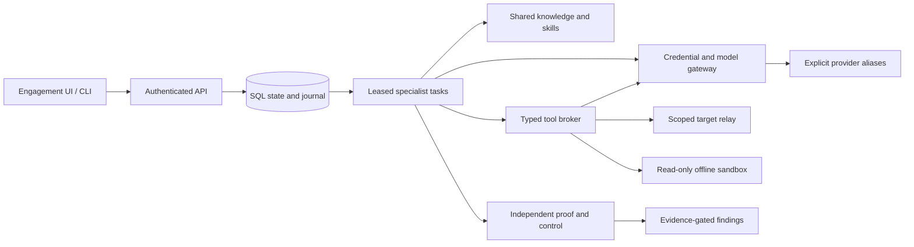

# ATLAS V3 implemented architecture

Updated 10 November 2026. Current owner instructions supersede the inherited greenfield and mandatory-MFA wording. No push, public deployment, VPS change or SBI target request occurred.

The modular monolith retains separate policy, broker, relay, gateway, knowledge, scheduling and verification modules. SQL is authoritative; Redis only improves wakeups. Tasks are independent, not eight permanent model conversations. A run pins campaign policy, source snapshot, model/provider versions, skills, instruction snapshot, deadlines, budgets and concurrency. Claims hold short locks, dispatch commits reservations before paid calls, and fencing prevents stale publication/execution.

Discovery subscriptions create bounded specialist tasks with provenance and reasons. Priority terms are visible; dependencies gate dispatch and failed prerequisites cancel their follow-ups. Shared context contains a small explicit observation view and bounded source/knowledge evidence, not every agent history.

Automatic model routing uses explicitly configured, immutable alias pools. Verification/deep research retain their selected model. Context, structured capability, enabled/healthy state, circuits, confirmed price metadata and observed latency influence choice. Fallback occurs only before dispatch. Completed malformed output can receive one separately metered correction; unknown billing is held and not replayed.

All target traffic is brokered through the frozen scope relay with DNS/address/redirect checks, bounds and destructive-action rejection. The minimal smoke profile is root HEAD only, no credentials/query and two requests maximum. Models have no arbitrary shell, DB/server/file administration, generic MCP tools or scanner installation channel. Production workers lack the provider master key and Docker socket. Approved read-only API/MCP credentials remain in the gateway.

Findings require independent proof/control replay and exact fresh artifact binding. Research notes and chain relationships stay unverified until evidence supports their claims. Reports include confirmed findings; hypotheses and rejected validation remain inspectable.

Local production-style deployment uses pinned images, nonroot/read-only application containers, separate networks/secrets, PostgreSQL/pgvector, Redis and Caddy. Public/VPS deployment remains an explicit owner operation. See the [current acceptance report](docs/test-results/DEPLOYMENT_ACCEPTANCE_2026-11-10.md).
